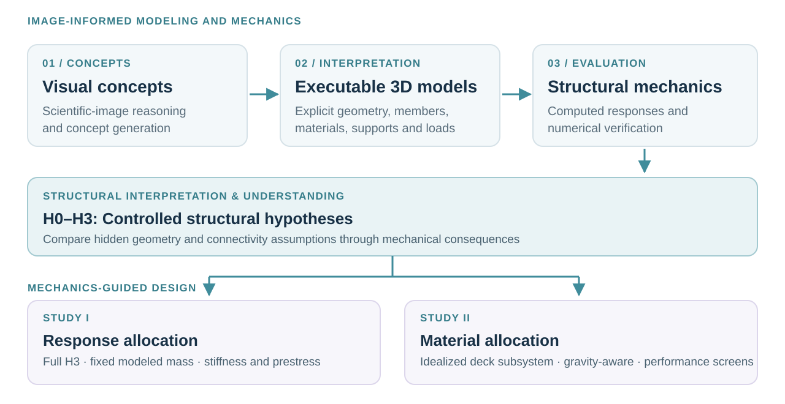

# 3D Structural Studio — Research Workflow

**From Bioinspired Images to Executable Structural Models**

[View the research workflow](https://wlululu.github.io/cephalo-silk-design-pipeline/)

This research workflow connects image-informed structural interpretation, explicit 3D modeling, numerical mechanics, and mechanics-guided design. The companion [3D Structural Studio](https://wlululu.github.io/cephalo-silk-structural-lab/) provides interactive models, mechanical responses, and supporting research data.

## Methodology

- **Visual concepts and 3D modeling:** Scientific-image reasoning and bioinspired concept generation support AI-assisted interpretation with researcher review. Explicit models define geometry, connectivity, sections, materials, supports, and loads.
- **Executable mechanics:** Case-specific solvers evaluate structural response, supported by equilibrium checks and numerical verification.
- **Structural interpretation and understanding:** Controlled Bridge hypotheses H0–H3 examine how alternative geometric and connectivity assumptions affect mechanical behavior.
- **Mechanics-guided design:** Two complementary studies investigate response allocation under a fixed modeled mass (**Study I**) and material allocation under prescribed performance criteria in an idealized, gravity-aware deck subsystem (**Study II**).

## Explore the research

The Studio includes three executable structural examples—**Twin-Arch Web Bridge**, **Loop Towers**, and **Woven-Wing Pavilion**—together with the Bridge interpretation and design studies.

- [Interactive 3D Structural Studio](https://wlululu.github.io/cephalo-silk-structural-lab/)
- [Application source and documentation](https://github.com/wlululu/cephalo-silk-structural-lab)
- [Research data](https://github.com/wlululu/cephalo-silk-structural-lab/releases/tag/research-viewer-minimal-v1)
- [Independent numerical verification](https://github.com/wlululu/cephalo-silk-structural-lab/releases/tag/bridge-cv-v1)
